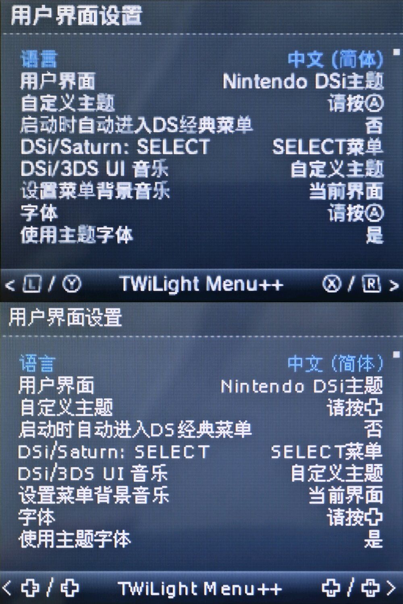

# TWiLight Menu++ CJK Glyph Tools (`nds-twl-font`)

<p align="center">
  
  
  
  
</p>

[English](README.md) · [简体中文](README.zh-CN.md)

Python utilities for rendering CJK fonts into pixel-aligned BMP glyph sheets. The generated BMPs can be imported into TWiLight Menu++ font files using a compatible NFTR editor.

These scripts only generate bitmap sheets for import; they do not edit NFTR files directly.

<p align="center">
  
</p>

---

## Directory Structure

```text
nds-twl-font/
├── scripts/
│   ├── PixelBitmap_Base.py           # Single-font fixed-offset generation
│   ├── PixelBitmap_AutoCenter.py      # Automatic centering for non-CJK characters
│   ├── PixelBitmap_DualFallback.py    # Dual-font fallback with per-font offsets
│   └── PixelBitmap_ColorFix.py        # Color normalization and anti-alias cleanup
├── fonts/
│   ├── fusionPixel_12px.bdf          # Fusion Pixel font (12px)
│   ├── wenquanyi_12px.bdf            # WenQuanYi Bitmap Song (12px)
│   └── wenquanyi_13px.bdf            # WenQuanYi Bitmap Song (13px)
├── default/
│   ├── small.nftr / .json            # Official small NFTR and char table
│   └── large.nftr / .json            # Official large NFTR and char table
├── assets/
│   └── comparison.jpg                # Demonstration graphic
├── README.md
└── README.zh-CN.md
```

---

## Requirements

- Python 3 with Pillow:
  ```powershell
  python -m pip install Pillow
  ```
- `small.nftr` or `large.nftr` from `sd:/_nds/TWiLightMenu/extras/fonts/Default/` (samples provided in `default/`);
- Character order JSON exported from your NFTR editor;
- An NFTR editor supporting BMP tile import.

---

## Workflow

1. Export character order JSON from the target NFTR.
2. Run the desired script in `scripts/` to generate bitmap sheets.
3. Review the output BMP at 1:1 native scale.
4. Import the BMP tiles into the base NFTR using your NFTR tool.
5. Deploy to `sd:/_nds/TWiLightMenu/extras/fonts/<FontName>/` on your console.
