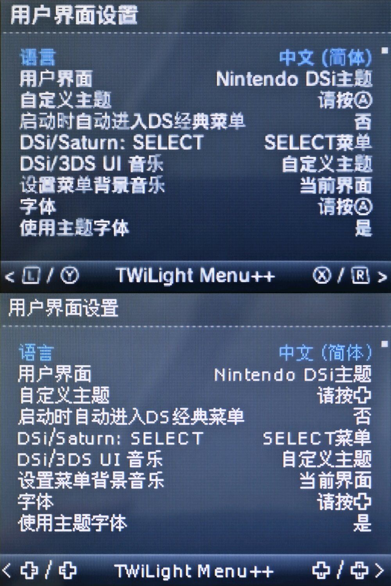

# TWiLight Menu++ CJK 字形位图工具 (`nds-twl-font`)

<p align="center">
  
  
  
  
</p>

[English](README.md) · [简体中文](README.zh-CN.md)

用于将 CJK 字体渲染为像素对齐 BMP 字形图的 Python 工具集。生成的 BMP 可通过兼容的 NFTR 编辑器导入 TWiLight Menu++ 字体。

这些脚本只生成供导入使用的位图，不会直接创建或修改 NFTR 文件。

<p align="center">
  
</p>

> [!IMPORTANT]
> 导入字体前请按原始像素尺寸检查生成结果。

---

## 目录与资产结构

```text
nds-twl-font/
├── scripts/
│   ├── PixelBitmap_Base.py           # 单字体固定偏移渲染引擎
│   ├── PixelBitmap_AutoCenter.py      # 非 CJK 字符自动水平居中引擎
│   ├── PixelBitmap_DualFallback.py    # 主副双字体回退与独立偏移引擎
│   └── PixelBitmap_ColorFix.py        # 位图颜色规范化与抗锯齿修复
├── fonts/
│   ├── fusionPixel_12px.bdf          # 融合像素 12px 点阵字库
│   ├── wenquanyi_12px.bdf            # 文泉驿 12px 点阵宋体
│   └── wenquanyi_13px.bdf            # 文泉驿 13px 点阵宋体
├── default/
│   ├── small.nftr / .json            # 官方小字体与字符表
│   └── large.nftr / .json            # 官方大字体与字符表
├── assets/
│   └── comparison.jpg                # 实机渲染效果对比图
├── README.md
└── README.zh-CN.md
```

---

## 环境准备

- Python 3；
- Pillow 图形库：
  ```powershell
  python -m pip install Pillow
  ```
- `sd:/_nds/TWiLightMenu/extras/fonts/Default/` 中的 `small.nftr` 或 `large.nftr`（已在 `default/` 目录附带备份）；
- 从 NFTR 编辑器导出的 JSON 字符顺序表；
- 支持从位图导入 tiles 的 NFTR 编辑器。

---

## 脚本功能详解

| 脚本 (`scripts/`) | 核心功能 |
|---|---|
| `PixelBitmap_Base.py` | 使用固定偏移生成单字体 BMP 字形图 |
| `PixelBitmap_AutoCenter.py` | 自动将非 CJK 字符在单元格中水平居中 |
| `PixelBitmap_DualFallback.py` | 主字体缺字时自动使用副字体（Fallback），并允许分别微调偏移 |
| `PixelBitmap_ColorFix.py` | 统一位图颜色，消除导入前的半透明像素或偏色 |

运行后将弹出图形化选择窗口，用于快速选取字符表 JSON、字体、输出路径。

---

## 制作流程

1. **导出字符顺序**：从目标 NFTR 导出字符顺序 JSON。
2. **生成字形位图**：根据对齐和补字需求运行 `scripts/` 下对应脚本。
3. **校验位图**：以 1:1 原始分辨率检查生成的 BMP 图样。
4. **导入 NFTR**：使用 NFTR 编辑器把生成的 BMP tiles 导入原始 NFTR。
5. **部署实机**：将保存后的字体放入 SD 卡 `sd:/_nds/TWiLightMenu/extras/fonts/<字体名>/`，并在实机上验证。

---

## 字体与许可证

仓库内置由文泉驿点阵宋体和 Fusion Pixel Font 衍生的 BDF 文件，原字体许可证继续适用。
